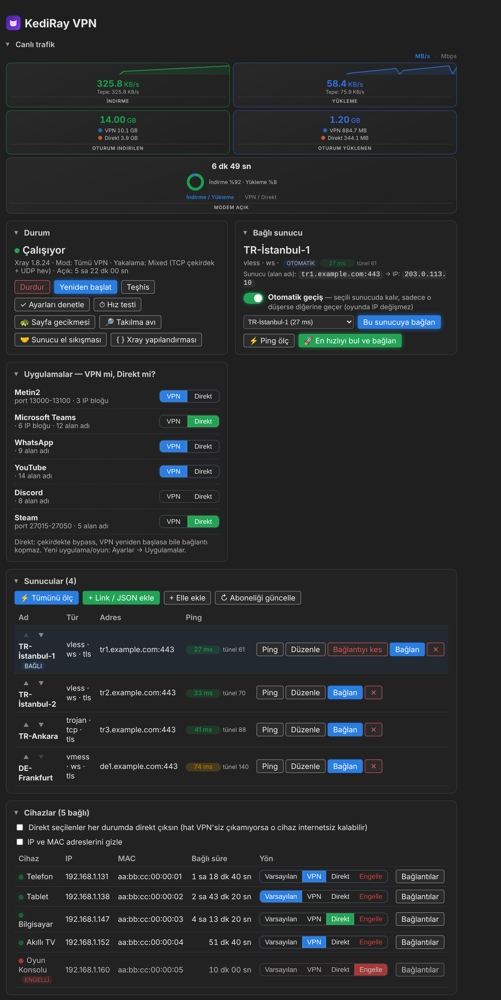
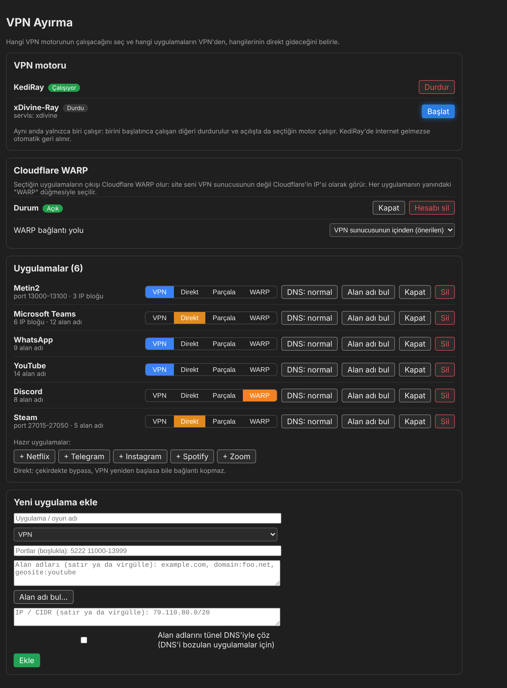

# KediRay

**Türkçe** · [English](#english)

OpenWrt için Xray tabanlı VPN. LuCI arayüzü ve `kediray` komut satırı aracıyla gelir. Geliştirici: Şaban Vurgun.

## Özellikler

- Xray tabanlı VPN, birden fazla sunucu (düğüm), en iyi sunucuyu otomatik seçme
- **Bağlantıyı kes:** sunucudan ayrıl, VPN açık kalsın, trafik doğrudan çıksın
- **VPN Ayırma:** uygulama bazında yol seçimi (VPN, doğrudan, WARP, parçalama)
- Trafik sayfası: bugün / bu hafta / bu ay kullanımı, kartları gizle ve sırala. VPN'siz, sade karşılığı ayrı bir uygulama olarak da var: [KediStat](https://github.com/sabanvurgun03-ui/kedistat)
- Bant sekmesi: modem bant taraması ve akıllı bant seçimi (QModem gerekir)
- Görünüm: açık/koyu ve renk temaları
- **Çekirdekler:** Xray'in yanında sing-box ve mihomo ikililerini panelden kur, dosyadan yükle ya da kaldır ve VPN'i hangi çekirdekle çalıştıracağını seç (Xray varsayılan; xhttp, WARP, TLS parçalama, reklam/geosite listeleri ve sertifika sabitleme yalnızca Xray'de)
- **Dil:** Türkçe, English, Français; sayfa başlığının sağındaki TR | EN | FR seçicisiyle değişir (seçim tarayıcıda saklanır)
- **Yedekle / geri yükle:** sunucular, uygulama kuralları ve ayarlar tek dosyada (modemi sıfırlayınca geri getir)
- GitHub Release'ten güncelleme (sha256sums doğrulamalı)
- [AW1K Panel](https://github.com/sabanvurgun03-ui/aw1kpanel) Android uygulamasıyla uyumlu

## Ekran görüntüleri

*KediRay VPN ana paneli (örnek verilerle): canlı hız, durum, bağlı sunucu, uygulama/cihaz yönü (VPN / Direkt) ve sunucu listesi.*

*VPN Ayırma: VPN motoru, Cloudflare WARP ve uygulama bazında VPN / Direkt / Parçala / WARP seçimi.*

## Sistem gereksinimleri

- **OpenWrt 22.03 veya üstü** (firewall4 / nftables şart; eski iptables'lı sürümlerde çalışmaz)
- Paket yöneticisi: `opkg` veya `apk`
- Kurulum sırasında internet (paketler için) ve LuCI (`luci-base`)
- Gerekli paketler (kurulum betiği eksikleri kendisi kurar): `ucode`, `ucode-mod-uci`, `ucode-mod-fs`, `ip-full`, `curl`, `ca-bundle`, `unzip`, `openssl-util`, `conntrack`, `xray-core`, `hev-socks5-tunnel`, `kmod-tun`, `kmod-nft-tproxy`, `kmod-nft-socket`, `v2ray-geoip`, `v2ray-geosite`
- Modemin paket deposunda bu paketler (özellikle `xray-core` ve `hev-socks5-tunnel`) bulunmalı
- Güncelleme için modemin `github.com` ve `raw.githubusercontent.com` adreslerine erişmesi gerekir
- Donanım: Xray ve geo dosyaları için yeterli boş flash ve RAM gerekir. Resmi bir alt sınır ölçülmedi; tahminen en az 128 MB RAM ve birkaç on MB boş flash önerilir
- Bant sekmesi yalnızca QModem'li hücresel modemlerde çalışır
- Test edilen cihaz: Arcadyan AW1000 (DivineWRT 25.12-NSS). Diğer cihazlarda denenmedi; sorun olursa kurulum betiği nedenini yazıp durur
- Donanım akış hızlandırması (hardware flow offloading) açıksa trafik VPN kurallarını atlayabilir; böyle bir durumda kapat

## Kurulum

Modemde SSH ile:

    wget -O /tmp/kediray.sh https://github.com/sabanvurgun03-ui/kediray/releases/latest/download/kediray-install.sh
    sh /tmp/kediray.sh

Kurulumdan sonra LuCI'de **VPN → KediRay VPN** menüsünü aç. Sayfa eski görünürse Ctrl+Shift+R yap.

## Depo düzeni

    package/kediray/files/        modemde çalışan dosyalar (kediray komutu, init, hotplug, *.uc)
    package/aw1k-panel/files/     AW1K Panel uygulamasının modem tarafı (aw1k-usage, rpcd eklentisi, ACL)
    luci-app-kediray/             LuCI arayüzü (JS görünümleri, menü, ACL)
    server/stats-worker/          anonim kullanım sayacı sunucusu (Cloudflare Worker)
    tools/                        build.py, kurulum betiği iskeleti ve paket şablonları
    VERSION                       tek sürüm kaynağı
    build.sh                      dist/ içine release dosyalarını üretir

`./build.sh` kurulum betiğini ve paketleri kaynak ağacından üretir ve doğrular. Aynı girdiden her seferinde birebir aynı çıktı verir.

## Güncelleme

LuCI → KediRay → **Hakkında → GitHub'dan güncelle**, ya da SSH:

    kediray update check
    kediray update install

Güncelleme, o sürümün GitHub Release'inden indirilir ve release'teki `sha256sums` ile doğrulanır. `sha256sums` yoksa ya da uyuşmazsa kurulmaz.

## Gizlilik (anonim kullanım sayısı)

KediRay hiçbir şeyi kendiliğinden göndermez. Panele ilk girişte "Geliştirmeye yardımcı olur musun?" diye bir kez sorar; **Evet** dersen günde bir kez rastgele bir kurulum kimliği, KediRay sürümü ve uygulama adı gönderilir. Sunucu bilgilerin, trafiğin, adın ve IP adresin kaydedilmez. Cevap vermezsen ya da **Hayır** dersen hiçbir şey gönderilmez. Ayarlar'dan ya da `kediray count off` ile istediğin an kapatabilirsin (kimlik silinir); ne gönderileceğini `kediray count show` gösterir. Toplayan sunucunun kodu [`server/stats-worker`](server/stats-worker) içinde açık durur.

## Yedekleme

LuCI → KediRay → **Hakkında → Yedekle / geri yükle**, ya da SSH:

    kediray backup /tmp/yedek.conf
    kediray restore /tmp/yedek.conf

Yedek dosyası sunucu kimliklerini (UUID) içerir. **Kimseyle paylaşma, GitHub'a yükleme.**

## Notlar

- Modemin GitHub'a erişebilmesi gerekir (`github.com`, `raw.githubusercontent.com`).
- Kurulum, aynı anda çalışan başka bir transparan proxy ile (örneğin xDivine-Ray) çakışabilir. Geçiş için: `kediray takeover`.

## Lisans

KediRay, [GNU GPL 3.0](LICENSE) (veya sonrası) ile lisanslanmıştır. © 2026 Şaban Vurgun. Değiştirip dağıtırsan kaynağı açık tutmalı ve telif bildirimini korumalısın.

---

## English

Xray-based VPN for OpenWrt, with a LuCI interface and the `kediray` command-line tool. Developer: Şaban Vurgun.

### Features

- Xray-based VPN with multiple servers (nodes) and automatic best-server selection
- **Disconnect:** leave the server but keep the VPN on, traffic goes out directly
- **Split routing:** per-app route (VPN, direct, WARP, fragmentation)
- Traffic page: today / this week / this month usage, hide and reorder cards. A plain, VPN-free version is also available as a separate app: [KediStat](https://github.com/sabanvurgun03-ui/kedistat)
- Band tab: modem band scan and smart band selection (needs QModem)
- Appearance: light/dark and color themes
- **Cores:** install, upload from a file or remove the sing-box and mihomo binaries next to Xray from the panel and choose which core runs the VPN (Xray is the default; xhttp, WARP, TLS fragmentation, ad/geosite lists and certificate pinning are Xray-only)
- **Languages:** Türkçe, English, Français; switch with the TR | EN | FR selector at the right of the page title (the choice is saved in the browser)
- **Backup / restore:** servers, app rules and settings in one file (bring them back after a router reset)
- Update from GitHub Releases (sha256sums verified)
- Works with the [AW1K Panel](https://github.com/sabanvurgun03-ui/aw1kpanel) Android app

### Screenshots

*KediRay VPN main panel (sample data): live speed, status, connected server, per-app/device route (VPN / Direct) and server list.*

*VPN split: VPN engine, Cloudflare WARP and per-app VPN / Direct / Fragment / WARP choice.*

### System requirements

- **OpenWrt 22.03 or newer** (firewall4 / nftables is required; older iptables-based releases do not work)
- Package manager: `opkg` or `apk`
- Internet access during install (for packages) and LuCI (`luci-base`)
- Required packages (the installer installs missing ones): `ucode`, `ucode-mod-uci`, `ucode-mod-fs`, `ip-full`, `curl`, `ca-bundle`, `unzip`, `openssl-util`, `conntrack`, `xray-core`, `hev-socks5-tunnel`, `kmod-tun`, `kmod-nft-tproxy`, `kmod-nft-socket`, `v2ray-geoip`, `v2ray-geosite`
- These packages (especially `xray-core` and `hev-socks5-tunnel`) must be available in your router's package feed
- Updates need the router to reach `github.com` and `raw.githubusercontent.com`
- Hardware: enough free flash and RAM for Xray and the geo files. No official minimum has been measured; roughly 128 MB RAM and a few tens of MB of free flash are recommended (estimate)
- The Band tab only works on cellular modems with QModem
- Tested device: Arcadyan AW1000 (DivineWRT 25.12-NSS). Not tested on other devices; if something is missing the installer stops and says why
- If hardware flow offloading is enabled, traffic may bypass the VPN rules; turn it off in that case

### Install

Over SSH on the router:

    wget -O /tmp/kediray.sh https://github.com/sabanvurgun03-ui/kediray/releases/latest/download/kediray-install.sh
    sh /tmp/kediray.sh

Then open **VPN → KediRay VPN** in LuCI. If the page looks stale, press Ctrl+Shift+R.

### Update

LuCI → KediRay → **About → Update from GitHub**, or over SSH:

    kediray update check
    kediray update install

The update is downloaded from that version's GitHub Release and checked against the release's `sha256sums`. It is not installed if `sha256sums` is missing or doesn't match.

### Privacy (anonymous usage count)

KediRay sends nothing on its own. The first time you open the panel it asks once whether you want to help; if you say **Yes**, it sends a random install ID, the KediRay version and the app name once a day. Your servers, traffic, name and IP address are not recorded. If you don't answer or say **No**, nothing is sent. Turn it off any time in Settings or with `kediray count off` (the ID is deleted); `kediray count show` prints exactly what would be sent. The collecting server's code is open in [`server/stats-worker`](server/stats-worker).

### Backup

LuCI → KediRay → **About → Backup / restore**, or over SSH:

    kediray backup /tmp/backup.conf
    kediray restore /tmp/backup.conf

The backup file contains server IDs (UUIDs). **Do not share it or upload it to GitHub.**

### Notes

- The router must be able to reach GitHub (`github.com`, `raw.githubusercontent.com`).
- It can conflict with another transparent proxy running at the same time (e.g. xDivine-Ray). To switch: `kediray takeover`.

### License

KediRay is licensed under the [GNU GPL 3.0](LICENSE) or later. © 2026 Şaban Vurgun. If you modify and distribute it, keep the source open and preserve the copyright notice.
