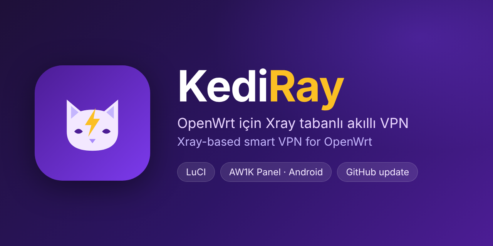
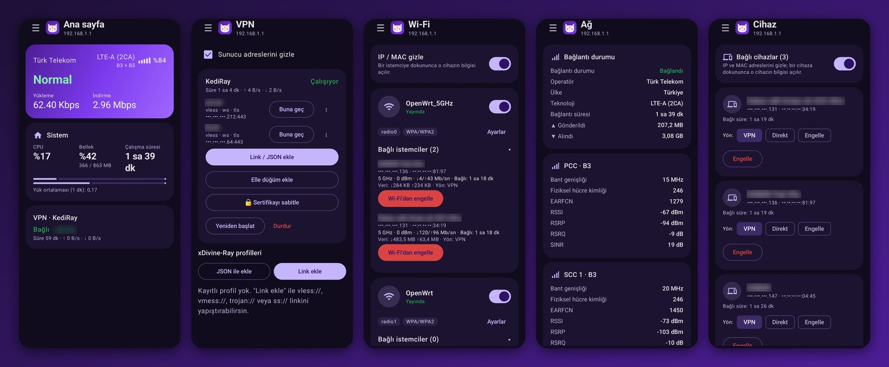

# KediRay

**Türkçe** · [English](#english)

OpenWrt için Xray tabanlı VPN. LuCI arayüzü ve `kediray` komut satırı aracıyla gelir. Geliştirici: Şaban Vurgun.

## Özellikler

- Xray tabanlı VPN, birden fazla sunucu (düğüm), en iyi sunucuyu otomatik seçme
- **Bağlantıyı kes:** sunucudan ayrıl, VPN açık kalsın, trafik doğrudan çıksın
- **VPN Ayırma:** uygulama bazında yol seçimi (VPN, doğrudan, WARP, parçalama)
- Trafik sayfası: bugün / bu hafta / bu ay kullanımı, kartları gizle ve sırala
- Bant sekmesi: modem bant taraması ve akıllı bant seçimi (QModem gerekir)
- Görünüm: açık/koyu ve renk temaları
- **Yedekle / geri yükle:** sunucular, uygulama kuralları ve ayarlar tek dosyada (modemi sıfırlayınca geri getir)
- GitHub Release'ten güncelleme (sha256sums doğrulamalı)
- [AW1K Panel](https://github.com/sabanvurgun03-ui/aw1kpanel) Android uygulamasıyla uyumlu

## Ekran görüntüleri

*AW1K Panel Android uygulaması: ana sayfa, VPN, Wi-Fi, ağ ve cihazlar.*

## Kurulum

Modemde SSH ile:

    wget -O /tmp/kediray.sh https://github.com/sabanvurgun03-ui/kediray/releases/latest/download/kediray-install.sh
    sh /tmp/kediray.sh

Kurulumdan sonra LuCI'de **VPN → KediRay VPN** menüsünü aç. Sayfa eski görünürse Ctrl+Shift+R yap.

## İndirmeler

Her sürümün dosyaları [Releases](https://github.com/sabanvurgun03-ui/kediray/releases) sayfasında:

| Dosya | Ne |
|---|---|
| `kediray-install.sh` | Tek dosya kurulum (yukarıdaki komutla aynı betik) |
| `kediray-all.tar.gz` | Firmware'e gömme paketi: dosya ağacı, ilk açılış betiği, paket listesi. Mimariden bağımsız (aarch64, armv7, mips, mipsel, riscv64, x86_64 ...), çünkü KediRay derlenmiş dosya içermez |
| `kediray-src.tar.gz` | Kaynak ağacı (derleme araçlarıyla birlikte) |
| `sha256sums` | Dosyaların SHA256 toplamları: `sha256sum -c sha256sums` |

AW1K Panel Android uygulamasının APK'sı aynı sayfada ayrı bir sürüm olarak durur.

## Depo düzeni

    package/kediray/files/        modemde çalışan dosyalar (kediray komutu, init, hotplug, *.uc)
    package/aw1k-panel/files/     AW1K Panel uygulamasının modem tarafı (aw1k-usage, rpcd eklentisi, ACL)
    luci-app-kediray/             LuCI arayüzü (JS görünümleri, menü, ACL)
    installer/                    kurulum betiği iskeleti + dosya haritası
    tools/                        build.py ve paket şablonları
    VERSION                       tek sürüm kaynağı
    build.sh                      dist/ içine release dosyalarını üretir

`./build.sh` kurulum betiğini ve paketleri kaynak ağacından üretir ve doğrular. Aynı girdiden her seferinde birebir aynı çıktı verir.

## Güncelleme

LuCI → KediRay → **Hakkında → GitHub'dan güncelle**, ya da SSH:

    kediray update check
    kediray update install

Güncelleme, o sürümün GitHub Release'inden indirilir ve release'teki `sha256sums` ile doğrulanır. `sha256sums` yoksa ya da uyuşmazsa kurulmaz.

## Yedekleme

LuCI → KediRay → **Hakkında → Yedekle / geri yükle**, ya da SSH:

    kediray backup /tmp/yedek.conf
    kediray restore /tmp/yedek.conf

Yedek dosyası sunucu kimliklerini (UUID) içerir. **Kimseyle paylaşma, GitHub'a yükleme.**

## Notlar

- Modemin GitHub'a erişebilmesi gerekir (`github.com`, `raw.githubusercontent.com`).
- Kurulum, aynı anda çalışan başka bir transparan proxy ile (örneğin xDivine-Ray) çakışabilir. Geçiş için: `kediray takeover`.

## Lisans

KediRay, [GNU GPL 3.0](LICENSE) (veya sonrası) ile lisanslanmıştır. © 2026 Şaban Vurgun. Değiştirip dağıtırsan kaynağı açık tutmalı ve telif bildirimini korumalısın.

---

## English

Xray-based VPN for OpenWrt, with a LuCI interface and the `kediray` command-line tool. Developer: Şaban Vurgun.

### Features

- Xray-based VPN with multiple servers (nodes) and automatic best-server selection
- **Disconnect:** leave the server but keep the VPN on, traffic goes out directly
- **Split routing:** per-app route (VPN, direct, WARP, fragmentation)
- Traffic page: today / this week / this month usage, hide and reorder cards
- Band tab: modem band scan and smart band selection (needs QModem)
- Appearance: light/dark and color themes
- **Backup / restore:** servers, app rules and settings in one file (bring them back after a router reset)
- Update from GitHub Releases (sha256sums verified)
- Works with the [AW1K Panel](https://github.com/sabanvurgun03-ui/aw1kpanel) Android app

### Screenshots

*AW1K Panel Android app: home, VPN, Wi-Fi, network and devices.*

### Install

Over SSH on the router:

    wget -O /tmp/kediray.sh https://github.com/sabanvurgun03-ui/kediray/releases/latest/download/kediray-install.sh
    sh /tmp/kediray.sh

Then open **VPN → KediRay VPN** in LuCI. If the page looks stale, press Ctrl+Shift+R.

### Downloads

Each release's files are on the [Releases](https://github.com/sabanvurgun03-ui/kediray/releases) page:

| File | What |
|---|---|
| `kediray-install.sh` | Single-file installer (the same script as the command above) |
| `kediray-all.tar.gz` | Firmware package: file tree, first-boot script, package list. Architecture-independent (aarch64, armv7, mips, mipsel, riscv64, x86_64 ...) because KediRay ships no compiled binaries |
| `kediray-src.tar.gz` | Source tree (with the build tools) |
| `sha256sums` | SHA256 sums of the files: `sha256sum -c sha256sums` |

The AW1K Panel Android APK sits on the same page as its own, separate release.
To build the files yourself: `./build.sh` (output goes to `dist/`; the same input always gives byte-identical files).

### Update

LuCI → KediRay → **About → Update from GitHub**, or over SSH:

    kediray update check
    kediray update install

The update is downloaded from that version's GitHub Release and checked against the release's `sha256sums`. It is not installed if `sha256sums` is missing or doesn't match.

### Backup

LuCI → KediRay → **About → Backup / restore**, or over SSH:

    kediray backup /tmp/backup.conf
    kediray restore /tmp/backup.conf

The backup file contains server IDs (UUIDs). **Do not share it or upload it to GitHub.**

### Notes

- The router must be able to reach GitHub (`github.com`, `raw.githubusercontent.com`).
- It can conflict with another transparent proxy running at the same time (e.g. xDivine-Ray). To switch: `kediray takeover`.

### License

KediRay is licensed under the [GNU GPL 3.0](LICENSE) or later. © 2026 Şaban Vurgun. If you modify and distribute it, keep the source open and preserve the copyright notice.
